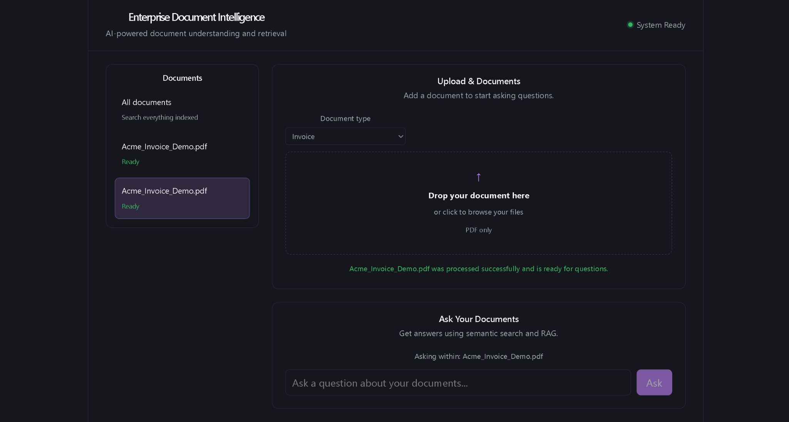
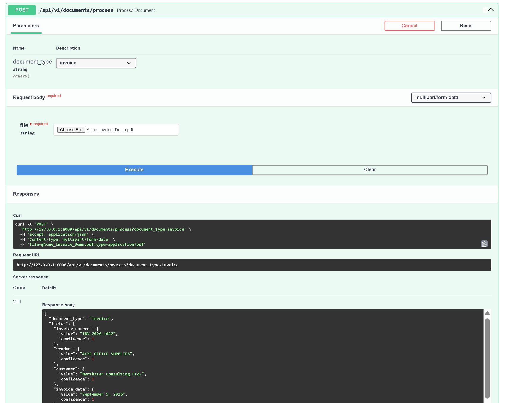
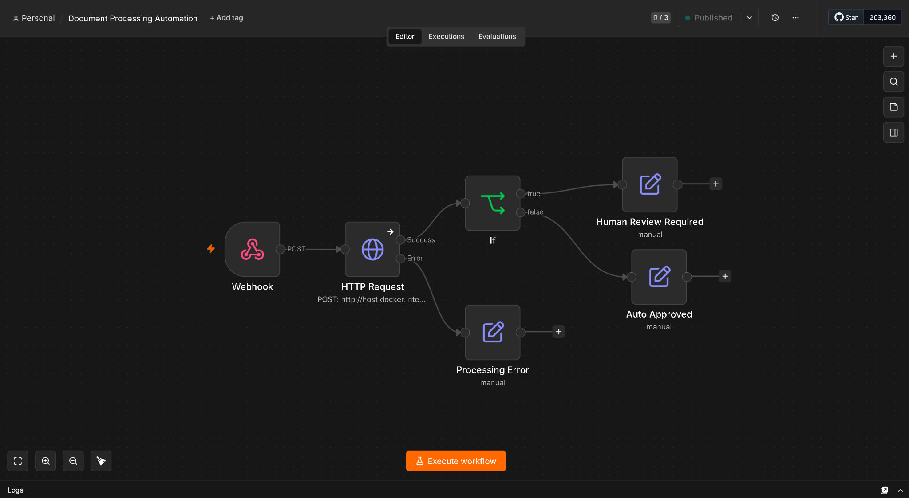
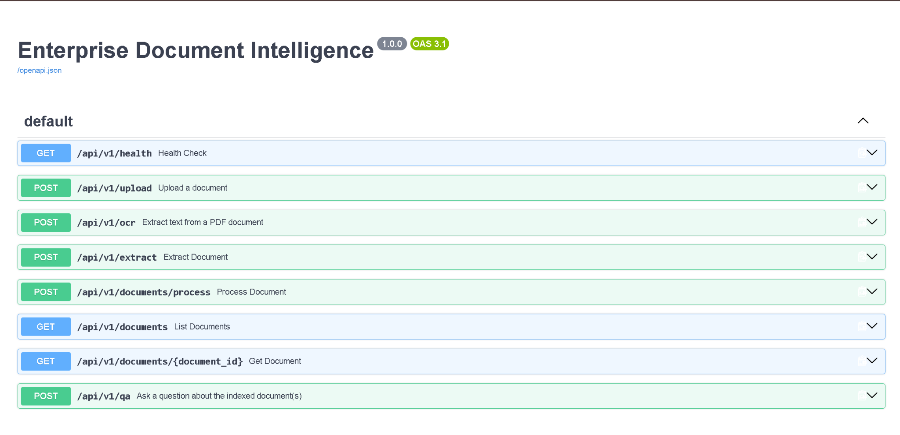

# Enterprise Document Intelligence Platform

> An AI-powered enterprise document processing platform that transforms unstructured PDF documents into structured data, searchable knowledge, and automated workflows.


---

## Overview

The Enterprise Document Intelligence Platform is a full-stack AI application designed to automate the processing and understanding of enterprise PDF documents.

The platform accepts documents such as resumes, invoices, contracts, purchase orders, receipts, and other business documents, then processes them through an AI-powered pipeline consisting of:

- File validation
- OCR processing
- Text chunking
- Semantic embeddings
- Vector storage and retrieval
- AI-powered structured extraction
- PostgreSQL persistence
- Retrieval-Augmented Generation (RAG)
- Automated workflow orchestration

The system combines a FastAPI backend, PostgreSQL database, Qdrant vector database, Google Gemini, Tesseract OCR, React/Vite frontend, and n8n automation.

The project was developed through ten structured phases, progressing from infrastructure and document ingestion through AI extraction, RAG, frontend integration, automation, production hardening, and final documentation.

---

## Demo / Screenshots

### Frontend — Document Processing & RAG

The React frontend provides document upload, processing status, document selection, and document-scoped RAG question answering.



### FastAPI — AI Document Extraction

The document processing API returns structured information extracted from the uploaded document, including field values and confidence scores.



### n8n — Document Processing Automation

The n8n workflow orchestrates document processing and routes results to human review or automatic approval based on the extraction confidence.



### REST API — Swagger Documentation

The FastAPI Swagger interface exposes the platform's versioned REST API for upload, OCR, extraction, document processing, document retrieval, health checks, and RAG question answering.



---

## Key Features

### Intelligent Document Processing

- PDF document upload
- File type validation
- File size validation
- Multi-page PDF processing
- PDF-to-image conversion
- Image preprocessing
- Tesseract OCR
- Per-page OCR confidence scoring

### AI Information Extraction

- Google Gemini integration
- Document-type-aware prompts
- Structured JSON extraction
- Field-level confidence information
- Overall extraction confidence
- Confidence-based human review flag
- LLM response validation
- Handling of malformed extraction responses

### Semantic Search and RAG

- Document text chunking
- Sentence Transformer embeddings
- Qdrant vector storage
- Semantic similarity search
- Document-specific retrieval
- Retrieval pipeline
- Context construction
- Gemini-powered question answering
- Safe fallback when relevant context is unavailable

### Data Persistence

- PostgreSQL
- SQLAlchemy ORM
- Alembic migrations
- Repository pattern
- Document metadata persistence
- OCR result persistence
- Extraction result persistence
- Processing status tracking

### Workflow Automation

The project includes two n8n workflows:

1. **FastAPI Health Check**
2. **Document Processing Automation**

The document processing workflow sends uploaded documents to the FastAPI processing pipeline and routes the result based on whether human review is required.

### Frontend

The project includes a React/Vite frontend for interacting with the backend document processing and question-answering APIs.

---

## Architecture

The application follows a layered backend architecture:

```text
                    React / Vite Frontend
                             |
                             v
                     FastAPI REST API
                             |
              +--------------+--------------+
              |              |              |
              v              v              v
        Upload / OCR    Documents       RAG / QA
              |              |              |
              +--------------+--------------+
                             |
                             v
                       Service Layer
                             |
          +------------------+------------------+
          |                  |                  |
          v                  v                  v
     OCR Services       Extraction        RAG Services
                         Services
          |                  |                  |
          v                  v                  v
     Tesseract           Gemini           Retrieval
                                           Pipeline
                                               |
                                               v
                                            Qdrant
                             |
                             v
                     Repository Layer
                             |
                             v
                         PostgreSQL
```

---

## End-to-End Document Processing Pipeline

The complete document processing flow is:

```text
PDF Upload
    |
    v
File Validation
    |
    v
OCR Processing
(Tesseract / Poppler)
    |
    v
Text Chunking
    |
    v
Semantic Embeddings
(Sentence Transformers)
    |
    +----------------------+
    |                      |
    v                      v
Qdrant                 Gemini
Vector Index           Structured Extraction
    |                      |
    +----------+-----------+
               |
               v
          PostgreSQL
           Persistence
```

### 1. Upload

The client uploads a PDF document through the FastAPI API.

The system validates the uploaded file according to configured file type and size limits.

### 2. OCR

The PDF is converted into images and processed using Tesseract OCR.

The OCR layer produces:

- Extracted text
- Page count
- OCR confidence information
- Processing information

### 3. Semantic Indexing

The extracted text is divided into chunks and converted into semantic embeddings using Sentence Transformers.

The resulting vectors and document metadata are stored in Qdrant for later semantic retrieval.

### 4. AI Extraction

OCR text is passed to the extraction service.

Google Gemini receives a document-type-aware prompt and returns structured information.

The response is parsed and validated before the extraction result is persisted.

The extraction process also produces confidence information and can mark a document as requiring human review.

### 5. Persistence

Document processing information is stored in PostgreSQL.

The main persisted entities include:

```text
Document
   |
   +---- OCRResult
   |
   +---- ExtractionResult
```

Processing status is tracked throughout the pipeline.

### 6. Retrieval

When a question is submitted, the question is converted into an embedding and compared against indexed document chunks in Qdrant.

Retrieval can optionally be scoped to a specific document.

### 7. RAG Question Answering

Retrieved document context is passed to the Gemini generation service.

The generated answer is grounded in the retrieved enterprise document content.

If relevant context cannot be found, the system can return a safe fallback instead of fabricating an answer.

---

## RAG Architecture

The question-answering pipeline follows a Retrieval-Augmented Generation architecture:

```text
User Question
      |
      v
Question Embedding
      |
      v
Qdrant Semantic Retrieval
      |
      v
Relevant Document Chunks
      |
      v
Context Construction
      |
      v
Google Gemini
      |
      v
Grounded Answer
```

The RAG implementation uses Sentence Transformers for embeddings and Qdrant for semantic retrieval.

Questions can be asked across indexed documents or scoped to a specific document where supported by the API.

The retrieved context is passed to Gemini rather than relying solely on the model's general knowledge.

---

## Technology Stack

| Layer | Technology |
|---|---|
| Language | Python |
| Backend | FastAPI |
| Frontend | React + Vite |
| Database | PostgreSQL |
| ORM | SQLAlchemy |
| Migrations | Alembic |
| OCR | Tesseract OCR |
| PDF Processing | Poppler |
| LLM | Google Gemini |
| Embeddings | Sentence Transformers |
| Vector Database | Qdrant |
| Automation | n8n |
| Containerization | Docker / Docker Compose |
| Testing | pytest |
| Version Control | Git / GitHub |

---

## Project Structure

```text
Enterprise-Document-Intelligence/
|
+-- backend/
|   |
|   +-- app/
|       |
|       +-- api/
|       |   +-- v1/
|       |       +-- documents.py
|       |       +-- extraction.py
|       |       +-- health.py
|       |       +-- ocr.py
|       |       +-- qa.py
|       |       +-- router.py
|       |       +-- upload.py
|       |
|       +-- core/
|       |   +-- config.py
|       |   +-- logging.py
|       |
|       +-- db/
|       |   +-- models/
|       |   +-- repositories/
|       |   +-- base.py
|       |   +-- session.py
|       |
|       +-- exceptions/
|       |
|       +-- llm/
|       |   +-- client.py
|       |   +-- prompts.py
|       |   +-- response_parser.py
|       |
|       +-- ocr/
|       |
|       +-- schemas/
|       |
|       +-- services/
|       |   +-- chunking_service.py
|       |   +-- document_processing_service.py
|       |   +-- document_query_service.py
|       |   +-- embedding_service.py
|       |   +-- extraction_service.py
|       |   +-- ocr_service.py
|       |   +-- rag_generation_service.py
|       |   +-- rag_qa_service.py
|       |   +-- retrieval_pipeline_service.py
|       |   +-- semantic_indexing_service.py
|       |   +-- upload_service.py
|       |   +-- vector_store_service.py
|       |
|       +-- storage/
|       +-- utils/
|       +-- main.py
|
+-- frontend/
|   |
|   +-- src/
|       +-- components/
|       +-- services/
|       +-- App.jsx
|       +-- App.css
|       +-- index.css
|       +-- main.jsx
|
+-- n8n/
|   +-- workflows/
|       +-- Document Processing Automation.json
|       +-- FastAPI Health Check.json
|
+-- docs/
|   +-- DAILY_LOG.md
|   +-- SETUP.md
|
+-- docker-compose.yml
+-- .env.example
+-- README.md
```

---

## REST API Documentation

The backend exposes versioned REST APIs under `/api/v1`.

| Method | Endpoint | Description |
|---|---|---|
| GET | `/api/v1/health` | Health check for the backend service |
| POST | `/api/v1/upload` | Upload a PDF document |
| POST | `/api/v1/ocr` | Run OCR processing |
| POST | `/api/v1/extract` | Run AI-based structured extraction |
| POST | `/api/v1/documents/process` | Run the complete document processing pipeline |
| GET | `/api/v1/documents` | List processed documents |
| GET | `/api/v1/documents/{document_id}` | Retrieve a document and its processing results |
| POST | `/api/v1/qa` | Ask a natural-language question using RAG |

### Health Check

`GET /api/v1/health`

Returns the current application health status.

### Document Processing

`POST /api/v1/documents/process`

Runs the complete processing pipeline:

```text
Upload
  |
  v
OCR
  |
  v
Semantic Indexing
  |
  v
AI Extraction
  |
  v
PostgreSQL Persistence
```

### RAG Question Answering

`POST /api/v1/qa`

Example request:

```json
{
  "query": "What programming languages are mentioned?",
  "limit": 5
}
```

The endpoint retrieves relevant document context and generates an answer using the configured LLM.

---

## n8n Automation

The project includes two exported n8n workflows stored under `n8n/workflows/`.

### FastAPI Health Check

```text
Manual Trigger
      |
      v
HTTP GET
http://host.docker.internal:8000/api/v1/health
```

This workflow manually checks whether the FastAPI backend is reachable.

### Document Processing Automation

```text
Webhook
   |
   v
FastAPI Document Processing
   |
   v
Processing Result
   |
   +-----------------------------+
   |                             |
   v                             v
requires_review = true      requires_review = false
   |                             |
   v                             v
Human Review Required       Auto Approved
```

The workflow also contains an error branch for processing failures.

The webhook accepts the uploaded document as a binary field named `file`.

The exported workflow files are:

- `n8n/workflows/Document Processing Automation.json`
- `n8n/workflows/FastAPI Health Check.json`

---

## Configuration

The application uses environment-based configuration through Pydantic Settings.

Sensitive configuration values are stored in environment files and excluded from version control. The repository includes `.env.example` as a configuration reference.

Typical configuration includes:

```env
DATABASE_URL=...
QDRANT_URL=...
N8N_URL=...
GEMINI_API_KEY=...
```

Additional configuration controls include:

- Upload directory
- Maximum upload size
- Allowed file types
- Tesseract executable path
- Poppler path
- OCR language
- PDF DPI
- OCR confidence threshold
- Gemini model
- Gemini extraction parameters
- Extraction confidence threshold

> Never commit real API keys, passwords, or other secrets.

---

## Local Setup

### Prerequisites

Install the following:

- Python 3.10+
- Docker Desktop
- Git
- Node.js and npm
- Tesseract OCR
- Poppler
- Google Gemini API access

### 1. Clone the Repository

```bash
git clone https://github.com/reubx03/Enterprise-Document-Intelligence.git
cd Enterprise-Document-Intelligence
```

### 2. Start Infrastructure

From the project root:

```bash
docker compose up -d
```

The Docker Compose stack provides:

- PostgreSQL
- Qdrant
- n8n

Verify the services:

```bash
docker compose ps
```

### 3. Configure the Backend

Move into the backend directory:

```bash
cd backend
```

Create a virtual environment:

```bash
python -m venv venv
```

Windows:

```bash
.\venv\Scripts\activate
```

Linux / macOS:

```bash
source venv/bin/activate
```

Install dependencies:

```bash
pip install -r requirements.txt
```

Create the backend environment file `.env`.

Configure the required database, Qdrant, n8n, OCR, upload, and Gemini settings using the repository's environment example as a reference.

### 4. Run Database Migrations

From the backend directory:

```bash
alembic upgrade head
```

### 5. Start FastAPI

From the backend directory:

```bash
uvicorn app.main:app --reload
```

The backend will be available at `http://127.0.0.1:8000`.

- Swagger UI: `http://127.0.0.1:8000/docs`
- ReDoc: `http://127.0.0.1:8000/redoc`

### 6. Start the Frontend

From the project root:

```bash
cd frontend
npm install
npm run dev
```

The frontend will be available at `http://localhost:5173`.

The frontend uses its environment configuration to determine the FastAPI backend URL.

---

## Services

| Service | Address |
|---|---|
| FastAPI | http://127.0.0.1:8000 |
| Swagger UI | http://127.0.0.1:8000/docs |
| ReDoc | http://127.0.0.1:8000/redoc |
| Frontend | http://localhost:5173 |
| PostgreSQL | localhost:5432 |
| Qdrant | http://localhost:6333 |
| Qdrant Dashboard | http://localhost:6333/dashboard |
| n8n | http://localhost:5678 |

---

## Testing

The backend contains automated unit and integration tests using pytest.

Run the complete test suite from the backend directory:

```bash
python -m pytest tests -v
```

The most recent full test run produced:

```text
139 collected
135 passed
4 failed
2 warnings
```

The known failures were associated with:

- Qdrant persistent-state/search isolation between test runs
- Outdated assertions expecting previous error-message text
- Vector search ordering/state behavior

The document processing API integration tests were subsequently updated for the hardened error messages and passed:

```text
3 passed
1 warning
```

The warning was related to the current Starlette/httpx TestClient dependency behavior.

The project therefore does not currently claim a 100% passing test suite.

A real end-to-end RAG integration test was also successfully validated earlier using:

- Sentence Transformer embeddings
- Qdrant
- Gemini
- Real document context

Repeated live Gemini testing was limited after the Gemini free-tier quota was reached during development.

---

## Reliability and Error Handling

The application uses stage-specific pipeline exceptions to distinguish failures occurring during different processing stages.

Relevant stages include:

- OCR
- Indexing
- Extraction

The API returns safe client-facing error messages while detailed internal exceptions are logged server-side.

For example, an OCR failure is exposed as:

```json
{
  "stage": "ocr",
  "detail": "Document OCR processing failed. Please try again later."
}
```

This prevents internal implementation details and upstream provider errors from being unnecessarily exposed to API clients.

Incoming API requests are also validated using Pydantic schemas before reaching the processing pipeline.

---

## Production Hardening

The current implementation includes the following production-oriented safeguards:

- Environment-based configuration
- `.env` files excluded from Git
- No tracked API keys or credentials
- Restricted CORS origins for the local frontend
- File type validation
- File size limits
- Stage-specific pipeline exceptions
- Safe client-facing API error messages
- Server-side error logging
- PostgreSQL persistent Docker volume
- Qdrant persistent Docker volume
- n8n persistent Docker volume
- Docker restart policies
- API input validation
- Health endpoint
- Automated unit and integration testing

The current deployment configuration is primarily intended for local/self-hosted environments.

---

## Known Limitations

The current portfolio version intentionally focuses on the core enterprise document intelligence workflow.

Current limitations include:

- No authentication
- No role-based access control
- No cloud deployment
- No Kubernetes deployment
- No CI/CD pipeline
- No distributed background job queue
- No cloud object-storage integration
- No advanced human-review dashboard
- Gemini API availability depends on the configured API quota
- OCR quality depends on source document quality
- Some Qdrant integration tests require better isolation from persistent local vector-store state
- No formal performance/load benchmarks have been captured

These limitations define the current scope rather than indicating missing core functionality.

---

## Future Enhancements

Potential future versions could add:

- JWT authentication
- Role-based access control
- Human review dashboard
- Background document processing
- Celery or similar task workers
- Redis caching
- Batch document processing
- Cloud object storage
- Email and cloud-drive ingestion
- Hybrid keyword + semantic search
- Multi-document reasoning
- AI agents
- Audit logging
- CI/CD pipelines
- Kubernetes deployment
- Cloud deployment
- Performance benchmarking
- Improved Qdrant test isolation

---

## 10-Phase Project Roadmap

The project was developed through the following ten phases:

1. Foundation / Infrastructure
2. Upload
3. OCR / Processing
4. AI Extraction / Persistence
5. Integration Testing
6. RAG / Semantic Search
7. Frontend / UI
8. n8n Automation
9. Production Hardening
10. Documentation / Portfolio / Deployment

Current development has completed the core implementation through Phase 9.

Phase 10 focuses on final documentation, portfolio presentation, and deployment preparation.

---

## Engineering Concepts Demonstrated

### Backend Engineering

- REST API design
- FastAPI
- Pydantic validation
- Dependency injection
- Layered architecture
- Service layer pattern
- Repository pattern
- API versioning
- Centralized exception handling

### Database Engineering

- PostgreSQL
- SQLAlchemy
- Alembic
- Relational data modeling
- Repository-based persistence
- Structured extraction persistence

### AI Engineering

- OCR pipelines
- Prompt engineering
- LLM integration
- Structured LLM output
- Response validation
- Confidence scoring
- Embedding generation
- Vector databases
- Semantic retrieval
- Retrieval-Augmented Generation

### Automation

- n8n webhooks
- API-based workflow orchestration
- Human-review routing
- Automatic approval routing
- Workflow error handling

### Software Engineering

- Environment-based configuration
- Docker Compose
- Automated testing
- Logging
- API validation
- Safe error handling
- Git-based development workflow

---

## Portfolio / Resume Summary

**Enterprise Document Intelligence Platform**

Built a full-stack AI document processing platform using FastAPI, PostgreSQL, Qdrant, Tesseract OCR, Google Gemini, React, Docker, and n8n.

Implemented an end-to-end pipeline that:

- Accepts enterprise PDF documents
- Performs OCR and confidence scoring
- Extracts structured information using Gemini
- Persists document results in PostgreSQL
- Generates semantic embeddings
- Stores vectors in Qdrant
- Retrieves relevant document context
- Performs RAG-based question answering
- Exposes versioned REST APIs
- Provides a React/Vite frontend
- Automates document processing using n8n
- Routes low-confidence results for human review
- Handles stage-specific failures with production-safe API responses

The project demonstrates practical AI engineering, backend architecture, OCR processing, LLM integration, vector search, RAG, workflow automation, testing, and production-oriented software engineering.

---

## License

This project is intended as a portfolio and educational project.

---

## Author

Reuben Mathew Tharakan

B.Tech in Artificial Intelligence & Data Science

This project was built as a flagship portfolio project demonstrating practical AI engineering, intelligent document processing, backend development, RAG systems, vector search, workflow automation, and enterprise software architecture.